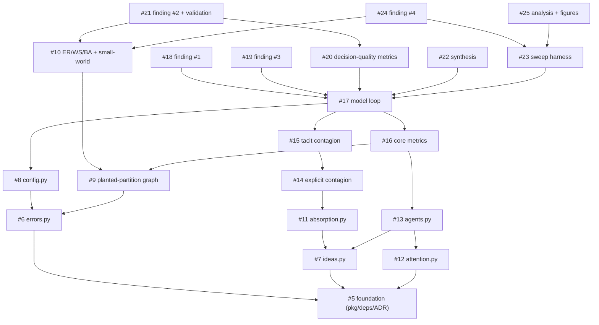

# build-order.md — OrgFlow Sequencing

Companion to `spec/spec.md`. This is the output of the **Outer Sequencing** pass:
the approved spec was decomposed into independently buildable GitHub issues
(#5–#25), and this document records the dependency analysis over those issues —
the dependency graph, the parallel execution groups, and the recommended build
order.

It is generated once, after the issues exist. The canonical contract is still
`spec/spec.md`; this file only orders the work that satisfies it.

## Issue inventory

| Issue | Title | Module(s) | Group | Order |
|------:|-------|-----------|:-----:|:-----:|
| [#5](../../issues/5)  | scaffold orgflow package, runtime deps, and no-Mesa ADR | `orgflow/` pkg, `pyproject.toml`, `docs/adr/0001` | G1 | 1 |
| [#6](../../issues/6)  | OrgFlowError exception hierarchy | `errors.py` | G2 | 3 |
| [#7](../../issues/7)  | idea and knowledge data models | `ideas.py` | G2 | 2 |
| [#8](../../issues/8)  | SimConfig configuration object | `config.py` | G3 | 8 |
| [#9](../../issues/9)  | planted-partition graph builder | `graph_builders.py` | G3 | 6 |
| [#10](../../issues/10) | ER/WS/BA topologies + small-world validation | `graph_builders.py`, `test_validation.py` | G4 | 11 |
| [#11](../../issues/11) | absorptive-capacity function | `absorption.py` | G3 | 5 |
| [#12](../../issues/12) | attention budget with congestion signal | `attention.py` | G2 | 4 |
| [#13](../../issues/13) | EmployeeAgent + knowledge-state transitions | `agents.py` | G3 | 7 |
| [#14](../../issues/14) | explicit contagion + strategy interface | `contagion.py` | G4 | 9 |
| [#15](../../issues/15) | tacit contagion (threshold + strong-tie gate) | `contagion.py` | G5 | 12 |
| [#16](../../issues/16) | core per-step metrics | `metrics.py` | G4 | 10 |
| [#17](../../issues/17) | two-phase model loop + pandas collector | `model.py` | G6 | 13 |
| [#18](../../issues/18) | reproduce finding #1 — bridges help explicit, fail tacit | `test_contagion.py` | G7 | 15 |
| [#19](../../issues/19) | reproduce finding #3 — bridge congestion | `test_attention.py` | G7 | 16 |
| [#20](../../issues/20) | problem sets, hidden fitness, decision-quality metrics | `metrics.py`, `ideas.py` | G7 | 14 |
| [#21](../../issues/21) | reproduce finding #2 — faster convergence, worse decisions | `test_validation.py` | G8 | 19 |
| [#22](../../issues/22) | idea synthesis / SECI combination | `synthesis.py`, `model.py` | G7 | 17 |
| [#23](../../issues/23) | single-run + batch-sweep harness | `run.py` | G7 | 18 |
| [#24](../../issues/24) | reproduce finding #4 — capability vs. communication | `test_*` (sweep) | G8 | 20 |
| [#25](../../issues/25) | sweep aggregation + figures | `analysis.py` | G8 | 21 |

## Dependency graph

Edges are the minimal blocking prerequisites (transitively reduced): an arrow
`A → B` means **B must be built before A**. Everything ultimately roots at the
foundation issue #5. A dependency is "B exists" (a sequencing fact), never "B's
internal design" — each issue's acceptance criteria are writable on their own.

Direct prerequisites, per issue (the "blocks on" set):

- **#5** — none (foundation; blocks all).
- **#6** — #5
- **#7** — #5
- **#8** — #6 (→ #5)
- **#9** — #6 (→ #5)
- **#10** — #9
- **#11** — #7
- **#12** — #5
- **#13** — #7, #12
- **#14** — #11 (→ #7)
- **#15** — #14
- **#16** — #9, #13 (→ #7, #12)
- **#17** — #8, #15, #16 (transitively pulls #7, #9, #11, #12, #13, #14)
- **#18** — #17
- **#19** — #17
- **#20** — #17
- **#21** — #20, #10
- **#22** — #17
- **#23** — #17
- **#24** — #23, #10
- **#25** — #23

## Parallel execution groups

Issues within a group share no interdependencies and can be built concurrently.
Each group depends only on groups above it.

| Group | Issues | Theme | Can start once… |
|:-----:|--------|-------|-----------------|
| **G1** | #5 | Foundation: package, deps, no-Mesa ADR | — |
| **G2** | #7, #6, #12 | Pure data & leaf modules (ideas, errors, attention) | G1 done |
| **G3** | #11, #9, #13, #8 | Absorption, graph, agent, config | their G1–G2 deps done |
| **G4** | #14, #16, #10 | Explicit contagion, core metrics, extra topologies | their G2–G3 deps done |
| **G5** | #15 | Tacit contagion (needs the strategy interface from #14) | #14 done |
| **G6** | #17 | Two-phase model loop — the integrator | all of G2–G5 done |
| **G7** | #20, #18, #19, #22, #23 | Decision-quality metrics, findings #1 & #3, synthesis, sweep | #17 done |
| **G8** | #21, #24, #25 | Finding #2 + connectivity validation, finding #4, analysis/figures | #20/#23 and #10 done |

Widest parallelism is in **G3** (4 issues), **G4** (3), and **G7** (5). The
critical path runs #5 → #7 → #11 → #14 → #15 → #17 → {#20 → #21} / {#23 → #24},
so #7, #11, #14, #15, and #17 are the highest-leverage items to land early.

## Recommended build order

A valid topological order (critical-path items pulled forward within each group):

1. **#5** — scaffold orgflow package, runtime deps, and no-Mesa ADR *(G1)*
2. **#7** — idea and knowledge data models *(G2)*
3. **#6** — OrgFlowError exception hierarchy *(G2)*
4. **#12** — attention budget with congestion signal *(G2)*
5. **#11** — absorptive-capacity function *(G3)*
6. **#9** — planted-partition graph builder *(G3)*
7. **#13** — EmployeeAgent + knowledge-state transitions *(G3)*
8. **#8** — SimConfig configuration object *(G3)*
9. **#14** — explicit contagion + strategy interface *(G4)*
10. **#16** — core per-step metrics *(G4)*
11. **#10** — ER/WS/BA topologies + small-world validation *(G4)*
12. **#15** — tacit contagion (threshold + strong-tie gate) *(G5)*
13. **#17** — two-phase model loop + pandas collector *(G6)*
14. **#20** — problem sets, hidden fitness, decision-quality metrics *(G7)*
15. **#18** — reproduce finding #1 — bridges help explicit, fail tacit *(G7)*
16. **#19** — reproduce finding #3 — bridge congestion *(G7)*
17. **#22** — idea synthesis / SECI combination *(G7)*
18. **#23** — single-run + batch-sweep harness *(G7)*
19. **#21** — reproduce finding #2 + connectivity→accuracy validation *(G8)*
20. **#24** — reproduce finding #4 — capability vs. communication *(G8)*
21. **#25** — sweep aggregation + figures *(G8)*

This order maps onto the milestones in `spec/plan.md`: G1–G6 (#5–#17) stands up
the graph, both contagion types, absorptive capacity, attention/congestion, and
the runnable model loop (**M1–M3**, making findings #1 and #3 reproducible in
G7); the decision-quality layer and its findings (**M4**, #20/#21) and the
synthesis + sweep + figures layer (**M5**, #22–#25, finding #4) follow. The
plan's suggested first slice (M1–M3) is therefore the prefix through order 16.

## Notes

- **Framework:** the model/agent layer is hand-rolled on **NetworkX + pandas**
  (no Mesa), per `spec/plan.md`. Issue #5 records this as ADR `0001`. This is a
  documented, intentional deviation from `spec-code.md §2`, not a hidden
  coupling.
- **`Message` placement:** the transmission record `Message` lives in `ideas.py`
  (#7) so that contagion (#14/#15), the agent (#13), and the model (#17) all
  depend on it without a cycle.
- **Dependency analysis vs. the approved spec:** no hidden coupling was found
  that contradicts the spec's independence assumptions. Decision quality (#20)
  is a shared prerequisite of both finding #2 and the connectivity→accuracy
  validation (#21), which is consistent with the spec. Nothing here required a
  halt-and-raise.
